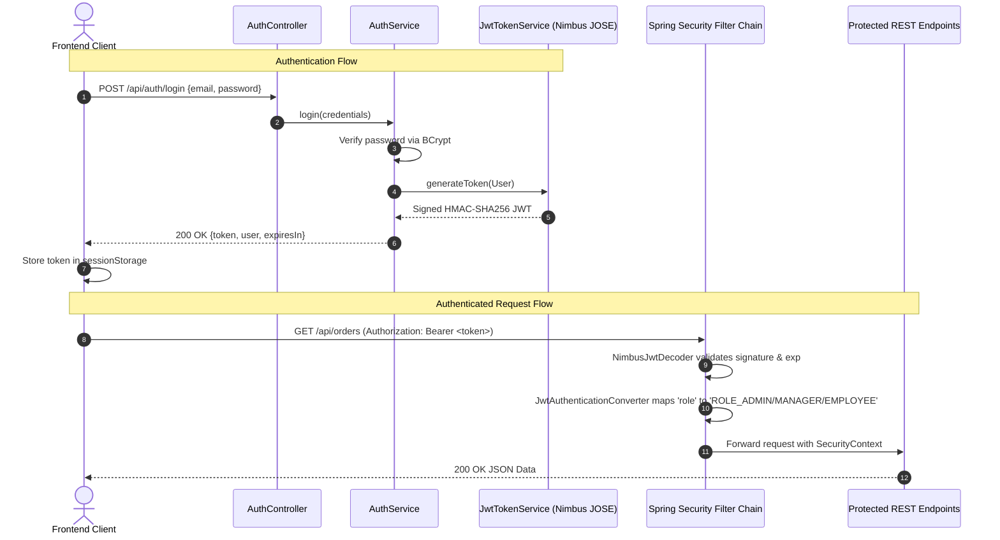

# StockFlow System Architecture

## 1. Executive Summary

StockFlow is a centralized, modular, full-stack Inventory and Order Management System designed to resolve stock discrepancies, eliminate spreadsheet reliance, and provide real-time operational visibility for small to medium-sized commercial enterprises.

The system is constructed as a **Layered Monolith** following industry-standard Spring Boot conventions, paired with a modern React single-page frontend.

---

## 2. Architecture Overview

```mermaid
graph TB
    subgraph Client["Client Browser (Single Page Application)"]
        UI["React 18 + Vite (Port 5173)"]
        Router["React Router v6"]
        AuthCtx["Auth Context (JWT State)"]
        Axios["Axios Client (Bearer Interceptor)"]
        UI --> Router
        Router --> AuthCtx
        AuthCtx --> Axios
    end

    subgraph ReverseProxy["Vite Dev Server Proxy"]
        Proxy["/api/* -> http://localhost:8090/api/*"]
        Axios --> Proxy
    end

    subgraph Backend["Spring Boot 4.1.2 Backend (Port 8090)"]
        SecurityFilter["Spring Security 7 Filter Chain"]
        JWTDecoder["Nimbus JWT Decoder & Validator"]

        subgraph WebLayer["REST Controller Layer"]
            AuthController["AuthController"]
            ProductController["ProductController"]
            OrderController["OrderController"]
            InventoryController["InventoryController"]
            CategoryController["CategoryController"]
            SupplierController["SupplierController"]
            CustomerController["CustomerController"]
            DashboardController["DashboardController"]
            UserController["UserController"]
        end

        subgraph ServiceLayer["Transactional Business Service Layer"]
            AuthService["AuthService"]
            ProductService["ProductService"]
            OrderService["OrderService (@Transactional)"]
            InventoryService["InventoryService (@Transactional)"]
            CategoryService["CategoryService"]
            SupplierService["SupplierService"]
            CustomerService["CustomerService"]
            DashboardService["DashboardService"]
            UserService["UserService"]
        end

        subgraph PersistenceLayer["Spring Data JPA & Hibernate"]
            ProductRepo["ProductRepository (Pessimistic Locking)"]
            OrderRepo["SalesOrderRepository"]
            OrderItemRepo["OrderItemRepository"]
            MovementRepo["StockMovementRepository"]
            CustomerRepo["CustomerRepository"]
            CategoryRepo["CategoryRepository"]
            SupplierRepo["SupplierRepository"]
            UserRepo["UserRepository"]
        end

        Proxy --> SecurityFilter
        SecurityFilter --> JWTDecoder
        JWTDecoder --> WebLayer
        WebLayer --> ServiceLayer
        ServiceLayer --> PersistenceLayer
    end

    subgraph Database["Relational Storage"]
        Postgres[("PostgreSQL 18 (Port 5432)<br/>Flyway Versioned Migrations")]
        PersistenceLayer --> Postgres
    end
```

---

## 3. Backend Layered Architecture

StockFlow strictly observes the **Controller-Service-Repository** pattern:

### 3.1. REST Controllers (`com.stockflow.*`)
- Responsible for parsing HTTP request parameters and JSON bodies.
- Enforces request validation using Jakarta Bean Validation (`@Valid`, `@NotBlank`, `@Min`, `@DecimalMin`).
- Delegates domain operations to corresponding services.
- Never accepts raw entities or exposes internal database schemas directly.
- Returns DTO records with standardized status codes (`200 OK`, `201 CREATED`, `204 NO_CONTENT`).

### 3.2. Service Layer
- Contains all business logic, transactional invariants, and authorization decisions.
- Methods mutating multiple tables are annotated with `@Transactional`.
- Implements concurrency protection:
  - Pessimistic write locks (`LockModeType.PESSIMISTIC_WRITE`) are acquired on product rows before updating stock balances.
  - Deterministic ascending lock ordering (`ORDER BY p.id ASC`) prevents database deadlocks when orders involve multiple products.
  - Historical price snapshots: Order items store the product unit price at the time of purchase, isolating past order records from future price updates.

### 3.3. Persistence & Repository Layer
- Extends Spring Data JPA's `JpaRepository` and `JpaSpecificationExecutor`.
- Implements dynamic filtering using JPA Specifications for search, status, and category filtering.
- Executes optimized aggregation queries for dashboard metrics and low-stock queries.

### 3.4. Global Exception Handling (`GlobalExceptionHandler`)
- Centralized `@RestControllerAdvice` intercepts exceptions across all controllers.
- Maps domain and validation exceptions to uniform `ErrorResponse` objects with timestamps, paths, and clear error descriptions:
  - `ResourceNotFoundException` -> `404 NOT FOUND`
  - `DuplicateResourceException` -> `409 CONFLICT`
  - `InsufficientStockException` -> `400 BAD REQUEST`
  - `BusinessException` -> `400 BAD REQUEST`
  - `MethodArgumentNotValidException` -> `400 BAD REQUEST` (with per-field error details)
  - `AccessDeniedException` -> `403 FORBIDDEN`
  - `BadCredentialsException` -> `401 UNAUTHORIZED`

---

## 4. Security & JWT Architecture

### Key Security Decisions:
1. **Stateless Sessions**: `SessionCreationPolicy.STATELESS` ensures the server holds no in-memory session state, allowing horizontal scalability.
2. **Nimbus JOSE + JWT**: Cryptographically signs tokens using HMAC-SHA256 (`HS256`).
3. **Public Registration Constraint**: Public self-registration through `/api/auth/register` is hardcoded to assign `Role.EMPLOYEE`. Administrative and Manager privileges can only be granted by an existing Administrator.
4. **Initial Administrator Bootstrap**: A dedicated `AdminBootstrap` (`CommandLineRunner`) checks on startup whether an administrator exists. If not, it provisions one from `ADMIN_EMAIL` and `ADMIN_PASSWORD` environment variables without committing credentials to version control.

---

## 5. Concurrency & Inventory Invariants

### 5.1. Dual-Entity Inventory Model
- **Product Entity (`currentStock`)**: Holds the current balance for fast lookups, low-stock checks, and order calculations.
- **StockMovement Entity**: Immutable audit ledger recording every balance modification with a timestamp, movement type (`STOCK_IN`, `STOCK_OUT`, `ADJUSTMENT`), delta, reference ID, and the authenticated user who initiated it.

### 5.2. Overselling Prevention Strategy
When a customer places an order:
1. The requested product IDs are sorted in ascending order (`List<Long> sortedIds = ...`).
2. Spring Data JPA queries `findAllByIdInWithLock(sortedIds)` with `PESSIMISTIC_WRITE` locking (`SELECT ... FOR UPDATE`).
3. If concurrent transactions attempt to checkout the same products, they are serialized at the database row level.
4. The system validates `currentStock >= requestedQuantity`. If insufficient, an `InsufficientStockException` is thrown, immediately rolling back the transaction.
5. If valid, stock is deducted, `OrderItem` records are created, and corresponding `StockMovement` entries are logged within the single transactional boundary.

---

## 6. Frontend Architecture

- **React 18 & Vite**: Fast development server and optimized production bundling.
- **Routing**: `react-router-dom` v6 with `PrivateRoute` wrappers enforcing client-side authentication and role-based views.
- **State Management**: Lightweight `AuthContext` managing authentication tokens, user identity, and session synchronization.
- **Centralized HTTP Client (`src/services/api.js`)**:
  - Request interceptor attaches `Authorization: Bearer <token>` dynamically from `sessionStorage`.
  - Response interceptor automatically handles `401 Unauthorized` responses by purging stored credentials and redirecting to `/login`.
- **Data Visualizations**: `recharts` for dynamic monthly revenue bar charts and category inventory distribution pie charts.
- **Iconography**: `lucide-react` for clean, consistent UI icons.
