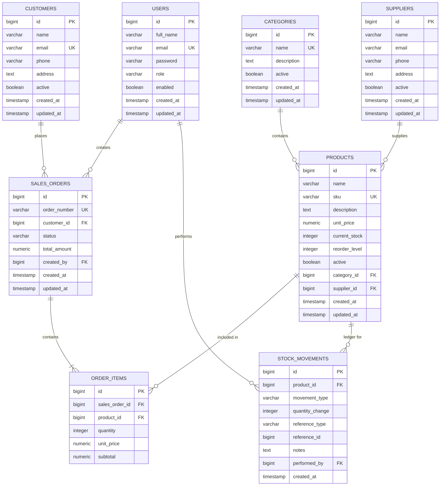

# StockFlow Database Design & Schema Specification

## 1. Entity-Relationship Overview

---

## 2. Table Specifications

### 2.1. `users`
Represents internal application operators and administrators.
| Column | Type | Constraints | Description |
|---|---|---|---|
| `id` | `BIGSERIAL` | PRIMARY KEY | Unique user identifier |
| `full_name` | `VARCHAR(100)` | NOT NULL | User's full display name |
| `email` | `VARCHAR(100)` | NOT NULL, UNIQUE | Login username |
| `password` | `VARCHAR(255)` | NOT NULL | BCrypt hashed password |
| `role` | `VARCHAR(20)` | NOT NULL | `ADMIN`, `MANAGER`, or `EMPLOYEE` |
| `enabled` | `BOOLEAN` | NOT NULL, DEFAULT TRUE | Account active/disabled flag |
| `created_at` | `TIMESTAMP` | NOT NULL, DEFAULT NOW() | Registration timestamp |
| `updated_at` | `TIMESTAMP` | NOT NULL, DEFAULT NOW() | Profile update timestamp |

### 2.2. `categories`
Logical categorization for products.
| Column | Type | Constraints | Description |
|---|---|---|---|
| `id` | `BIGSERIAL` | PRIMARY KEY | Unique category identifier |
| `name` | `VARCHAR(100)` | NOT NULL, UNIQUE | Category title |
| `description` | `TEXT` | NULLABLE | Detailed description |
| `active` | `BOOLEAN` | NOT NULL, DEFAULT TRUE | Soft-delete status |
| `created_at` | `TIMESTAMP` | NOT NULL, DEFAULT NOW() | Creation timestamp |
| `updated_at` | `TIMESTAMP` | NOT NULL, DEFAULT NOW() | Modification timestamp |

### 2.3. `suppliers`
External vendors supplying inventory goods.
| Column | Type | Constraints | Description |
|---|---|---|---|
| `id` | `BIGSERIAL` | PRIMARY KEY | Unique supplier identifier |
| `name` | `VARCHAR(150)` | NOT NULL | Supplier business name |
| `email` | `VARCHAR(100)` | NULLABLE | Supplier contact email |
| `phone` | `VARCHAR(30)` | NULLABLE | Phone contact |
| `address` | `TEXT` | NULLABLE | Warehouse or office location |
| `active` | `BOOLEAN` | NOT NULL, DEFAULT TRUE | Soft-delete status |
| `created_at` | `TIMESTAMP` | NOT NULL, DEFAULT NOW() | Creation timestamp |
| `updated_at` | `TIMESTAMP` | NOT NULL, DEFAULT NOW() | Modification timestamp |

### 2.4. `products`
The core inventory catalog items.
| Column | Type | Constraints | Description |
|---|---|---|---|
| `id` | `BIGSERIAL` | PRIMARY KEY | Product primary key |
| `name` | `VARCHAR(150)` | NOT NULL | Product name |
| `sku` | `VARCHAR(50)` | NOT NULL, UNIQUE | Stock Keeping Unit |
| `description` | `TEXT` | NULLABLE | Technical or sales notes |
| `unit_price` | `NUMERIC(12, 2)` | NOT NULL, CHECK (>= 0) | Selling price per unit |
| `current_stock` | `INT` | NOT NULL, DEFAULT 0, CHECK (>= 0) | Current balance |
| `reorder_level` | `INT` | NOT NULL, DEFAULT 10, CHECK (>= 0) | Low stock alert threshold |
| `active` | `BOOLEAN` | NOT NULL, DEFAULT TRUE | Soft-delete flag |
| `category_id` | `BIGINT` | FK -> `categories(id)` ON DELETE RESTRICT | Assigned category |
| `supplier_id` | `BIGINT` | FK -> `suppliers(id)` ON DELETE SET NULL | Assigned vendor |
| `created_at` | `TIMESTAMP` | NOT NULL, DEFAULT NOW() | Creation timestamp |
| `updated_at` | `TIMESTAMP` | NOT NULL, DEFAULT NOW() | Modification timestamp |

### 2.5. `customers`
Clients purchasing products through sales orders.
| Column | Type | Constraints | Description |
|---|---|---|---|
| `id` | `BIGSERIAL` | PRIMARY KEY | Unique customer identifier |
| `name` | `VARCHAR(150)` | NOT NULL | Customer name or company |
| `email` | `VARCHAR(100)` | UNIQUE, NULLABLE | Contact email |
| `phone` | `VARCHAR(30)` | NULLABLE | Phone number |
| `address` | `TEXT` | NULLABLE | Billing and shipping address |
| `active` | `BOOLEAN` | NOT NULL, DEFAULT TRUE | Soft-delete status |
| `created_at` | `TIMESTAMP` | NOT NULL, DEFAULT NOW() | Creation timestamp |
| `updated_at` | `TIMESTAMP` | NOT NULL, DEFAULT NOW() | Modification timestamp |

### 2.6. `sales_orders`
Commercial customer order header.
| Column | Type | Constraints | Description |
|---|---|---|---|
| `id` | `BIGSERIAL` | PRIMARY KEY | Unique order identifier |
| `order_number` | `VARCHAR(50)` | NOT NULL, UNIQUE | Readable identifier (`ORD-YYYYMMDD-XXXXX`) |
| `customer_id` | `BIGINT` | FK -> `customers(id)` ON DELETE RESTRICT | Purchasing customer |
| `status` | `VARCHAR(20)` | NOT NULL | `CONFIRMED`, `PENDING`, `CANCELLED` |
| `total_amount` | `NUMERIC(12, 2)` | NOT NULL, DEFAULT 0.00 | Server-calculated total |
| `created_by` | `BIGINT` | FK -> `users(id)` ON DELETE SET NULL | Employee who processed order |
| `created_at` | `TIMESTAMP` | NOT NULL, DEFAULT NOW() | Order placement timestamp |
| `updated_at` | `TIMESTAMP` | NOT NULL, DEFAULT NOW() | Order update timestamp |

### 2.7. `order_items`
Individual line items belonging to a sales order.
| Column | Type | Constraints | Description |
|---|---|---|---|
| `id` | `BIGSERIAL` | PRIMARY KEY | Line item primary key |
| `sales_order_id`| `BIGINT` | FK -> `sales_orders(id)` ON DELETE CASCADE | Parent order |
| `product_id` | `BIGINT` | FK -> `products(id)` ON DELETE RESTRICT | Ordered product |
| `quantity` | `INT` | NOT NULL, CHECK (> 0) | Quantity purchased |
| `unit_price` | `NUMERIC(12, 2)` | NOT NULL, CHECK (>= 0) | Price snapshot at order creation |
| `subtotal` | `NUMERIC(12, 2)` | NOT NULL, CHECK (>= 0) | `quantity * unit_price` |

### 2.8. `stock_movements`
The immutable inventory audit ledger.
| Column | Type | Constraints | Description |
|---|---|---|---|
| `id` | `BIGSERIAL` | PRIMARY KEY | Movement primary key |
| `product_id` | `BIGINT` | FK -> `products(id)` ON DELETE CASCADE | Product affected |
| `movement_type` | `VARCHAR(20)` | NOT NULL | `STOCK_IN`, `STOCK_OUT`, `ADJUSTMENT` |
| `quantity_change`| `INT` | NOT NULL | Signed integer (+50, -10) |
| `reference_type`| `VARCHAR(50)` | NULLABLE | Context (`SALES_ORDER`, `MANUAL_ADJUSTMENT`) |
| `reference_id` | `BIGINT` | NULLABLE | Associated entity ID (e.g. `order_id`) |
| `notes` | `TEXT` | NULLABLE | Human-readable audit explanation |
| `performed_by` | `BIGINT` | FK -> `users(id)` ON DELETE SET NULL | Authenticated user responsible |
| `created_at` | `TIMESTAMP` | NOT NULL, DEFAULT NOW() | Event timestamp |

---

## 3. Database Indexes

To guarantee sub-millisecond query execution on frequently filtered columns, the following indexes are defined across the schema:

1. `users`:
   - `idx_users_email` ON `users(email)`
   - `idx_users_role` ON `users(role)`
2. `categories`:
   - `idx_categories_name` ON `categories(name)`
   - `idx_categories_active` ON `categories(active)`
3. `suppliers`:
   - `idx_suppliers_name` ON `suppliers(name)`
   - `idx_suppliers_active` ON `suppliers(active)`
4. `products`:
   - `idx_products_sku` ON `products(sku)`
   - `idx_products_name` ON `products(name)`
   - `idx_products_category` ON `products(category_id)`
   - `idx_products_supplier` ON `products(supplier_id)`
   - `idx_products_active` ON `products(active)`
5. `customers`:
   - `idx_customers_name` ON `customers(name)`
   - `idx_customers_email` ON `customers(email)`
   - `idx_customers_active` ON `customers(active)`
6. `sales_orders`:
   - `idx_sales_orders_number` ON `sales_orders(order_number)`
   - `idx_sales_orders_customer` ON `sales_orders(customer_id)`
   - `idx_sales_orders_status` ON `sales_orders(status)`
   - `idx_sales_orders_created_at` ON `sales_orders(created_at)`
7. `order_items`:
   - `idx_order_items_order` ON `order_items(sales_order_id)`
   - `idx_order_items_product` ON `order_items(product_id)`
8. `stock_movements`:
   - `idx_stock_movements_product` ON `stock_movements(product_id)`
   - `idx_stock_movements_type` ON `stock_movements(movement_type)`
   - `idx_stock_movements_created_at` ON `stock_movements(created_at)`

---

## 4. Key Design Decisions

1. **Monetary Precision with `NUMERIC(12, 2)` & `BigDecimal`**:
   Floating point numbers (`FLOAT`, `DOUBLE`) suffer from IEEE-754 binary rounding inaccuracies. All monetary values (`unit_price`, `subtotal`, `total_amount`) use fixed-point `NUMERIC(12, 2)` in PostgreSQL and `BigDecimal` in Java.
2. **Soft Deletes**:
   To prevent referential integrity violations and preserve historical sales metrics, products, categories, suppliers, and customers utilize an `active` boolean column rather than hard `DELETE` queries.
3. **Pessimistic Row Locking (`SELECT ... FOR UPDATE`)**:
   During order processing and manual stock adjustments, product records are locked with `LockModeType.PESSIMISTIC_WRITE` to serialize stock deduction and prevent concurrent overselling.
4. **Flyway Versioned Migrations**:
   Schema evolution is managed strictly through numbered SQL scripts (`V1__create_users_table.sql` through `V8__create_stock_movements_table.sql`) instead of relying on Hibernate's `ddl-auto: update`, ensuring safe production deployments.
