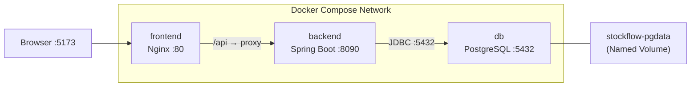

# StockFlow — Docker Deployment Guide

This guide explains how the StockFlow application is containerized and how to run the full stack using Docker Compose.

---

## 1. Architecture Overview

StockFlow runs as three independent Docker containers, orchestrated by Docker Compose:



| Container | Technology | Internal Port | Host Port | Purpose |
|---|---|---|---|---|
| **db** | PostgreSQL 17 Alpine | 5432 | 5433 | Persistent relational database |
| **backend** | Java 21 JRE + Spring Boot | 8090 | 8090 | REST API, business logic, JWT auth |
| **frontend** | Nginx Alpine | 80 | 5173 | Serves React SPA, proxies `/api` to backend |

### Why these ports?

- **Host port 5433** for the container database avoids conflicts with your local PostgreSQL installation on port 5432.
- **Host port 8090** matches the existing backend development port.
- **Host port 5173** matches the existing Vite development port so bookmarks and documentation still work.

---

## 2. Key Docker Concepts

### What are Docker images and containers?

A **Docker image** is a read-only blueprint containing the operating system, runtime, application code, and dependencies needed to run a service. A **container** is a running instance of an image — an isolated, lightweight process.

### Why multi-stage builds?

Multi-stage builds use separate build and runtime stages:

1. **Build stage**: Installs compilers, build tools (Maven, Node.js), and dependencies, then compiles the application.
2. **Runtime stage**: Copies only the compiled artifact (JAR file or static assets) into a minimal image.

This produces small, secure production images without build tools or source code.

### Why Docker Compose?

Docker Compose defines all three services, their networking, volumes, health checks, and startup ordering in a single `compose.yaml` file. One command starts the entire stack.

### Docker networking and service names

All three containers share a dedicated **bridge network** (`stockflow-network`). Containers communicate using service names as hostnames:

- The backend connects to PostgreSQL at `db:5432` (not `localhost:5432`).
- Nginx proxies `/api` requests to `backend:8090` (not `localhost:8090`).

### Named volumes and data persistence

The PostgreSQL container stores data in a **named Docker volume** (`stockflow-pgdata`). This volume persists independently of the container lifecycle — data survives `docker compose down` and `docker compose up -d`.

> [!CAUTION]
> Running `docker compose down -v` **deletes the named volume and all database data permanently**. Never use `-v` unless you intentionally want a clean database.

---

## 3. File Structure

```text
.
├── .env.example                     # Environment variable template
├── .env                             # Your local secrets (never committed)
├── .gitattributes                   # LF line endings for shell scripts
├── compose.yaml                     # Docker Compose orchestration
├── docker/
│   └── postgres/
│       └── init/
│           └── 01-create-stockflow-db.sh  # First-run DB initialization
└── stockflow/
    ├── backend/
    │   ├── Dockerfile               # Multi-stage Java build
    │   ├── .dockerignore
    │   └── src/main/resources/
    │       └── application-docker.yml  # Docker-specific Spring profile
    └── frontend/
        ├── Dockerfile               # Multi-stage React/Nginx build
        ├── .dockerignore
        └── nginx.conf               # Nginx reverse proxy config
```

---

## 4. Environment Setup

### Step 1: Copy the environment template

```powershell
Copy-Item .env.example .env
```

### Step 2: Edit `.env` and set your secrets

Open `.env` in a text editor and set these **required** values:

| Variable | Description | Example |
|---|---|---|
| `POSTGRES_ADMIN_PASSWORD` | PostgreSQL container superuser password | `MySecureAdminPass123` |
| `DB_PASSWORD` | Password for the `stockflow_app` database role | `MySecureAppPass456` |
| `JWT_SECRET` | 256-bit hex string for JWT signing | (keep the default or generate a new one) |

Optional overrides:

| Variable | Default | Description |
|---|---|---|
| `DB_USERNAME` | `stockflow_app` | Application database user |
| `FRONTEND_PORT` | `5173` | Host port for the frontend |
| `BACKEND_PORT` | `8090` | Host port for the backend |
| `DB_HOST_PORT` | `5433` | Host port for PostgreSQL |
| `ADMIN_EMAIL` | `admin@stockflow.com` | Bootstrap admin email |
| `ADMIN_PASSWORD` | `<ADMIN_PASSWORD>` | Bootstrap admin password |

> [!IMPORTANT]
> Never commit `.env` to source control. It is already listed in `.gitignore`.

---

## 5. Commands Reference

### Start the entire application

```powershell
docker compose up -d
```

This builds images (if needed), creates containers, and starts all three services.

### Validate Compose configuration

```powershell
docker compose config
```

### Build or rebuild images

```powershell
# Build all images
docker compose build

# Rebuild only the backend
docker compose build backend

# Rebuild only the frontend
docker compose build frontend
```

### Check container status

```powershell
docker compose ps
```

### View logs

```powershell
# All services
docker compose logs -f

# Backend only
docker compose logs -f backend

# Database only
docker compose logs -f db

# Frontend only
docker compose logs -f frontend
```

### Stop the application (preserving data)

```powershell
docker compose down
```

This stops and removes containers and networks, but **preserves the database volume**.

### Restart after code changes

```powershell
docker compose down
docker compose build backend
docker compose up -d
```

---

## 6. Accessing the Application

| Service | URL |
|---|---|
| **Frontend UI** | http://localhost:5173 |
| **Backend API** | http://localhost:8090 |
| **Swagger UI** | http://localhost:8090/swagger-ui.html |
| **Backend Health** | http://localhost:8090/actuator/health |

Default admin credentials: `admin@stockflow.com` / `<ADMIN_PASSWORD>`

---

## 7. Accessing PostgreSQL Inside the Container

```powershell
docker compose exec db psql -U stockflow_app -d stockflow
```

To use the admin superuser:

```powershell
docker compose exec db psql -U postgres
```

---

## 8. Understanding Host Port vs. Container Port

```
Host machine                      Docker container
┌──────────────┐                  ┌──────────────┐
│  Port 5433   │ ──── maps to ── │  Port 5432   │  (PostgreSQL)
│  Port 8090   │ ──── maps to ── │  Port 8090   │  (Spring Boot)
│  Port 5173   │ ──── maps to ── │  Port 80     │  (Nginx)
└──────────────┘                  └──────────────┘
```

- **Host port**: The port on your machine. Use this in your browser or tools.
- **Container port**: The port inside the container. Containers use this to communicate with each other via Docker DNS.

---

## 9. Troubleshooting

### Container won't start — port already in use

```
Error: bind: address already in use
```

Another process is using the host port. Either stop that process or change the port in `.env`:

```properties
FRONTEND_PORT=3000
BACKEND_PORT=9090
DB_HOST_PORT=5434
```

### Backend fails with database connection error

Check that the `db` container is healthy:

```powershell
docker compose ps db
```

Check database logs:

```powershell
docker compose logs db
```

Common causes:
- `DB_PASSWORD` in `.env` doesn't match what was used when the volume was first initialized.
- The database initialization script had Windows CRLF line endings (ensure `.gitattributes` forces LF).

### Backend health check fails

```powershell
docker compose logs backend
```

Look for Spring Boot startup errors. The health check calls `http://localhost:8090/actuator/health` inside the container.

### Frontend shows blank page or API errors

Check that the backend is healthy first:

```powershell
docker compose ps backend
```

Check Nginx proxy logs:

```powershell
docker compose logs frontend
```

### Reset everything (destructive)

> [!CAUTION]
> This deletes all database data permanently.

```powershell
docker compose down -v
docker compose up -d --build
```

---

## 10. Data Persistence

Database data is stored in the Docker named volume `stockflow-pgdata`. To verify it exists:

```powershell
docker volume inspect stockflow-pgdata
```

Data survives:
- `docker compose stop` → `docker compose start`
- `docker compose down` → `docker compose up -d`
- `docker compose restart`

Data is **deleted** by:
- `docker compose down -v`
- `docker volume rm stockflow-pgdata`
